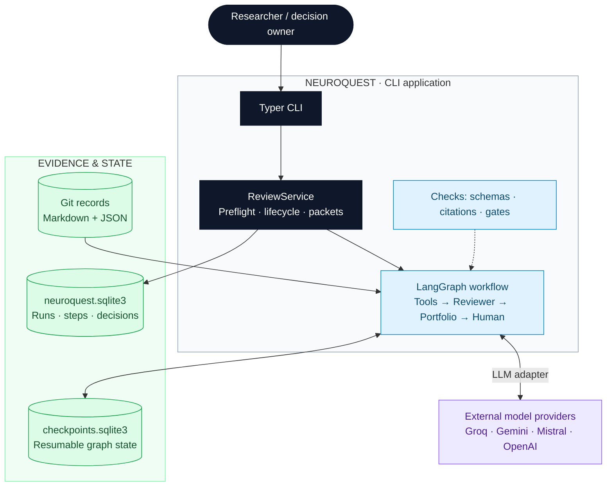
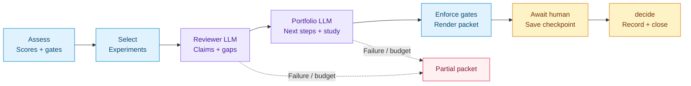

# NeuroQuest — Alzheimer’s research decision support

NeuroQuest turns Alzheimer’s research questions into traceable, human-reviewed decision packets: compare candidates, check evidence and gates, and recommend next steps.

> Candidate, experiment, and campaign-history records are **SYNTHETIC DEMONSTRATION** data. Literature summaries cite real publications. No candidate is approved or promoted.

**Stack:** Python 3.13 · Pydantic · Typer · LangGraph · SQLite · Groq / Gemini / Mistral / OpenAI. [Current status](STATUS.md) · [Project overview](PROJECT.md) · [Stack decisions](docs/architecture/tech-stack.md)

## Architecture

One process coordinates two sequential LLM roles and a human decision. Scores, gates, IDs, and allowed dispositions are computed in Python.



| Component | Responsibility |
| --- | --- |
| [CLI](src/neuroquest/cli.py) | Commands and output. |
| [Service](src/neuroquest/service.py) | Run lifecycle and decisions. |
| [Repository](src/neuroquest/repository/loader.py) | Validate records, resolve IDs, select evidence. |
| [Scoring](src/neuroquest/scoring.py) | Scores, gates, allowed dispositions. |
| [Graph](src/neuroquest/graph/build.py) | Workflow, checks, human pause. |
| [LLM adapters](src/neuroquest/llm/) | Providers, prompts, fake client. |
| [Storage](src/neuroquest/storage/db.py) / [renderer](src/neuroquest/packet.py) | History and Markdown packets. |

### From question to decision



The **reviewer** identifies supported observations, disputes, and gaps from selected candidate and experiment records. The **portfolio** role recommends dispositions and one informative next study.

**Gates beat scores and model output.** Failed gates or hard blocks allow only `blocked`; unknown gates prevent advancement. The CLI never offers promotion. Pydantic validates outputs; reviewer citations to unseen records are removed, and identical supported/disputed claims stay disputed. These checks do not establish scientific truth.

### Evidence, persistence, and controls

- **Evidence:** Markdown + JSON frontmatter in Git. Selection uses record references. Papers are loaded but not automatically sent to the reviewer; search is deferred.
- **History:** `var/neuroquest.sqlite3` stores runs, validated handoffs, usage, costs, packets, and append-only decisions. Decisions include actor, reason, time, and the reviewed packet’s hash.
- **Resume:** `var/checkpoints.sqlite3` stores graph state. A later `decide` invocation resumes the human pause without a model call. Candidate files are not modified.
- **Prompts:** shared rules + `roles/<role>/CLAUDE.md` + output schemas. Evidence is delimited as untrusted data; prompt versions are hashed.
- **Cost:** [settings](src/neuroquest/settings.py) supply models, keys, prices, and the $0.10 default cap. Pre-call estimates and reported usage track spend; failures yield partial packets. LangSmith tracing is optional.
- **Deployment:** local CLI or non-root Docker, read-only repo mount, persistent state volume. No HTTP server or queue.

**Built:** reviewer → portfolio → human, scoring, checks, persistence, history. **Planned:** researcher/planner/regulatory nodes, FTS5, `evidence`/`plan`, research connectors. [STATUS.md](STATUS.md) tracks implementation; [application design](docs/architecture/application-design.md) includes future scope.

## Repository layout

| Path | Contents |
| --- | --- |
| `src/neuroquest/`, `tests/app/` | Application and offline tests |
| `molecules/`, `experiments/`, `literature/` | Candidates, experiments, publications |
| `knowledge/`, `regulatory/`, `memory/` | Biology, gaps, fictional campaign history |
| `roles/`, `.claude/` | Role contracts and assistant customization |
| `docs/`, `adr/` | Design documentation and decisions |
| `config/`, `workflows/`, `runbooks/` | Contracts and procedures |
| `scripts/`, `tests/` | Repository validator, checks, Docker scripts |

## Run the application

Requires [uv](https://docs.astral.sh/uv/) (installs Python 3.13) or Docker. Copy [.env.example](.env.example) to `.env`; configure keys for your providers, model IDs, and `NEUROQUEST_MODEL_PRICES`.

```sh
uv sync
uv run neuroquest review A G N   # packet + run_id; pauses for a decision
uv run neuroquest decide <run_id> -d A=follow-up -d G=hold -d N=blocked --reason "Exposure first"
uv run neuroquest runs           # history; show <run_id> reprints a packet
uv run pytest                   # offline application tests
```

Docker: `scripts/start.sh` builds and starts the container; run `docker exec neuroquest neuroquest review A G N`. `scripts/stop.sh` keeps history in the `neuroquest-var` volume (`--purge` deletes it). Use the read-only `.env` mount: `docker --env-file` breaks quoted price JSON. Override the cap with `--budget-usd`.

## Working with Claude Code

[CLAUDE.md](CLAUDE.md) routes assistants through task/status → role → index → selected records. See [context guide](docs/context-guide.md) and [Claude setup](docs/claude-code.md).

| Invocation | Purpose |
| --- | --- |
| `/research-status` | Current task, status, next action |
| `/neuroquest-review A G N` | Compare candidates and check gates |
| `/neuroquest-evidence <claim>` | Sources and counterevidence |
| `/neuroquest-plan <candidate> <gap>` | Study concept |
| `/validate-research` | Offline checks |

Assistant commands are separate from the CLI. A Stop hook runs validation. [TASK.md](TASK.md) lists owner decisions; [docs](docs/README.md) indexes the design.

## Local checks

Python 3.10+, standard library only:

```sh
python3 scripts/validate_repository.py
python3 -m unittest discover -s tests -v
```

Checks cover links, IDs, scores, gates, evidence, ADRs, settings, and context budgets. App tests use a fake LLM; live evaluations are opt-in.

## Configuration and licensing

The app reads git-ignored `.env`; assistants must not read it. [config/](config/README.md) holds contracts. Code and docs use the [MIT License](LICENSE); publications retain their own terms.
