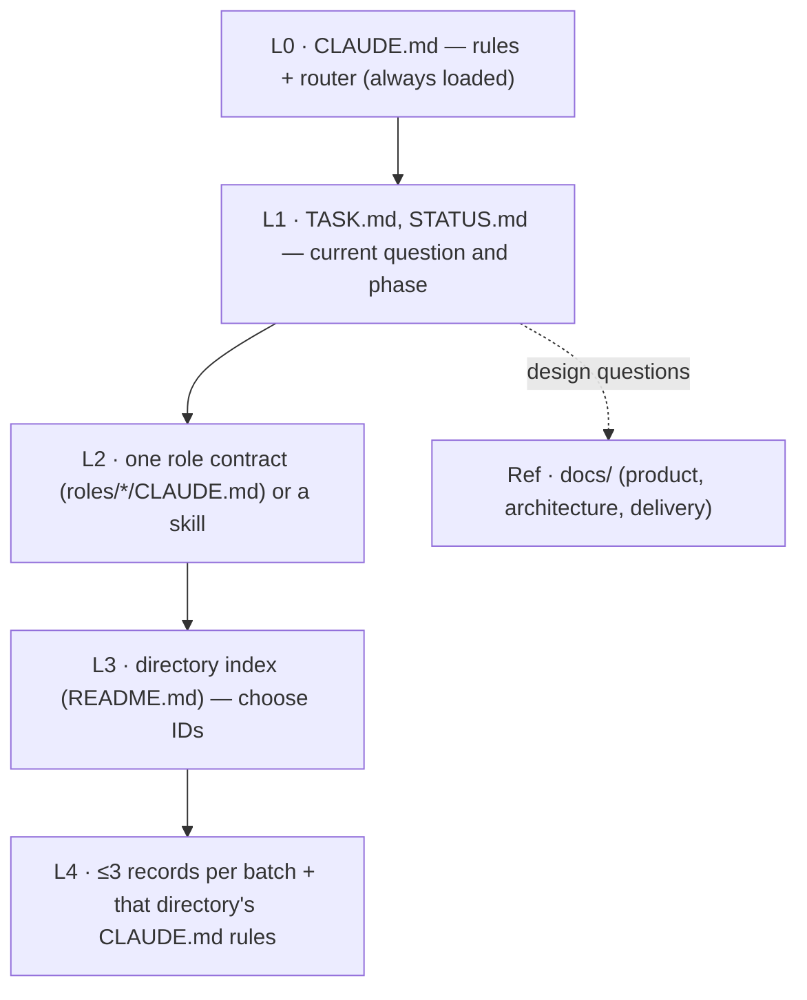
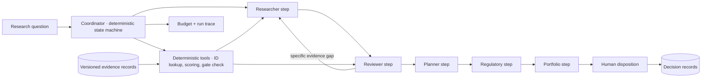

# Architecture — current repository and proposed target

Design proposal for owner review. Related decisions: [ADR-003](../../adr/ADR-003.md), [ADR-004](../../adr/ADR-004.md), [ADR-006](../../adr/ADR-006.md).

## Current state
Versioned Markdown records with JSON frontmatter, descriptive JSON contracts, role contracts, Claude Code skills/commands, and an offline validator wired to a Stop hook and CI. No application server, coordinator, LLM client, vector index, live connector, or persistent run state exists.

## Context architecture (in use today)
The repository is itself a layered context system for an LLM agent. Each layer is loaded only when the layer above routes to it.

Measured sizes and budgets: [context guide](../context-guide.md).

## Proposed application architecture

| Component | Responsibility | LLM? |
| --- | --- | --- |
| Coordinator (LangGraph) | Scope the question, select needed steps, enforce budget and transition rules, stop on block or exhaustion | No |
| Deterministic tools | Resolve IDs, load records, compute scores, evaluate gates, validate handoff schema | No |
| Role steps | Evidence synthesis, critique, study concepts, gap assessment, recommendation | Yes — OpenAI, tiered by role |
| Evidence store | Markdown/JSON records in git; SQLite FTS5 index; SQLite checkpoints and decisions | No |
| Decision recorder | Attributable human disposition tied to a packet version | No (human action) |

Roles are logical steps, not services or mandatory calls. The coordinator skips roles the question does not need. Arithmetic, IDs, and gates never go through model generation.

## Data ownership
Candidate records own current ratings and gates; experiments own observations; literature owns source summaries; ADRs own design rationale; [STATUS.md](../../STATUS.md) owns project phase. Indexes summarize and must be reconciled after primary changes. Schemas: [data contracts](data-contracts.md).

## Failure handling
| Condition | Behavior |
| --- | --- |
| Invalid evidence | Return to reviewer; gate `unknown` or `fail` |
| Missing evidence | Incomplete recommendation listing the gap |
| Hard block | Advancement stops; block shown in the packet |
| Tool or source unavailable | Typed failure with access limit; no invented content |
| Budget exhausted | Explicit partial result with unresolved questions |

Selected stack (TD-01–TD-10): Python 3.12, Pydantic v2 with strict typing, Typer CLI, LangGraph, OpenAI SDK, SQLite, LangSmith, Docker ([tech-stack](tech-stack.md)). No HTTP API or queue in the first version. Cross-cutting: [security](security-and-data-governance.md), [cost](observability-and-cost.md), [evaluation](../delivery/evaluation-plan.md).
